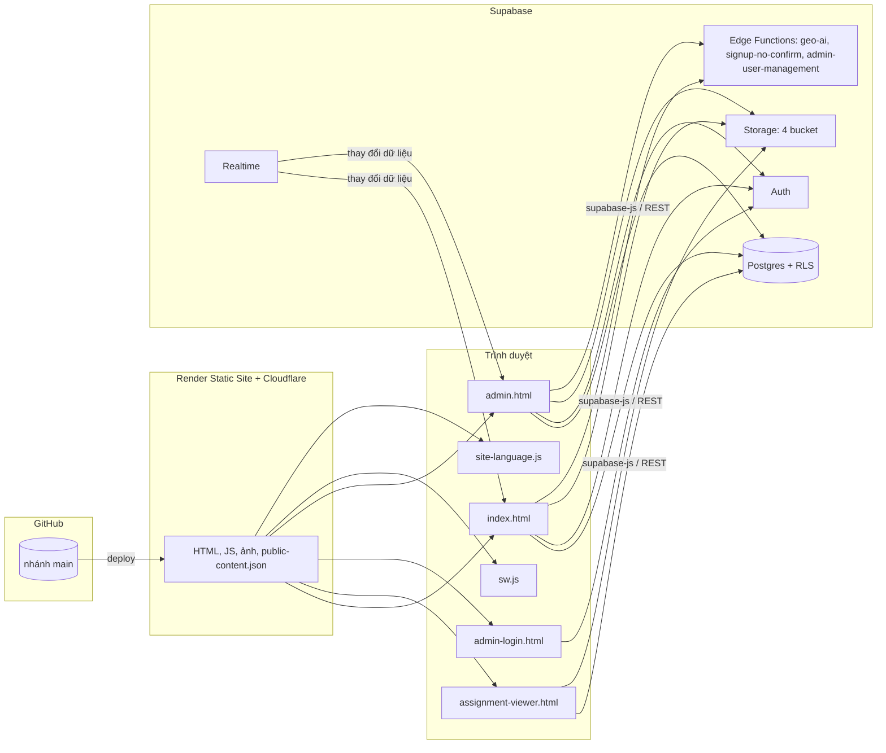

# Kiến trúc hệ thống

Website là trang tĩnh: GitHub lưu mã, Render (qua Cloudflare, tự deploy từ `main`) phát file, còn dữ liệu, đăng nhập, file và phân quyền do Supabase đảm nhận. Trình duyệt gọi Supabase trực tiếp bằng *publishable key*, nên an toàn dữ liệu phụ thuộc hoàn toàn vào Row Level Security (RLS) và policy Storage.

## Trang và liên kết giữa các trang

| Trang | Vai trò | Liên kết đi |
| --- | --- | --- |
| `index.html` | Trang công khai một trang: Trang chủ, Giới thiệu, Dự án, Bài tập & tài liệu, Liên hệ, Trợ lý ảo; các cửa sổ Tìm kiếm, Chi tiết dự án, Nhận xét riêng, Đăng nhập, Đăng ký | `assignment-viewer.html?id=…` (tab mới; cùng tab trên mobile), `admin-login.html` (chân trang) |
| `assignment-viewer.html` | Xem nội dung một bài tập: PDF (iframe), Word/PowerPoint/Excel (Office Online Viewer), nội dung rich-text, liên kết ngoài, tải file | `index.html#assignments` |
| `admin-login.html` | Đăng nhập quản trị; kiểm tra `profiles.role = 'admin'` | `admin.html` khi hợp lệ |
| `admin.html` | Bảng quản trị 9 mục; tự chuyển về `admin-login.html` nếu không phải admin | `index.html` |

Không có module dùng chung: mỗi trang tự khai báo cấu hình Supabase, hàm `escapeHtml`/`esc` và `sanitizeRichHtml` (lặp ở 3 trang). File dùng chung duy nhất là `assets/site-language.js`.

## Phiên đăng nhập

supabase-js lưu phiên ở `localStorage` với khóa `ptt-portfolio-auth`, dùng chung giữa trang công khai và trang quản trị trên cùng trình duyệt. Trang xem tài liệu tạo client với `persistSession: false`, nên luôn đọc với quyền khách.

## Tải nội dung công khai (`index.html`)

1. **Cache `localStorage`** `ptt-public-cache-v3` (hạn 10 phút): nếu còn hạn, vẽ ngay.
2. Nếu không: **snapshot** `public-content.json` (cùng origin) để có nội dung sớm.
3. **Supabase** qua supabase-js (timeout 6,5 s) → nếu lỗi, **REST** trực tiếp (timeout 5 s) → nếu lỗi, snapshot.
4. Song song: phiên đăng nhập (`auth.getUser`), ảnh Giới thiệu (`site_settings`).
5. Khi rảnh (`requestIdleCallback`): mở kênh Realtime `ptt-public-content`; thảo luận công khai chỉ tải khi mục Bài tập sắp vào màn hình.
6. Làm mới an toàn: khi tab được focus (sau 90 s), khi hiện lại (sau 120 s), và định kỳ 5 phút.

## Realtime

| Kênh | Trang | Bảng theo dõi | Phản ứng |
| --- | --- | --- | --- |
| `ptt-public-content` | `index.html` | `projects`, `assignments`, `assignment_subjects`*, `site_settings`, `academic_chat_messages` | Tải lại nội dung, ảnh Giới thiệu hoặc thảo luận |
| `admin-notifications-v1` | `admin.html` | INSERT trên `comments`, `academic_chat_messages`, `messages` | Cập nhật danh sách, huy hiệu chưa đọc, thông báo |

\* `assignment_subjects` không nằm trong publication Realtime, nên không bao giờ phát sự kiện.

`admin.html` còn phát `BroadcastChannel('ptt-content-sync')` sau mỗi thay đổi, nhưng không trang nào lắng nghe kênh này.

## Service worker (`sw.js`)

Đăng ký từ `index.html` với `?v=20261015-refresh1`, phạm vi `/`, cache `ptt-static-v23-20261015`.

| Loại request | Chiến lược |
| --- | --- |
| `admin.html`, `admin-login.html` | Luôn đi mạng, không cache |
| `/public-content.json` | Mạng trước (`no-store`), lỗi thì dùng cache |
| Điều hướng HTML | Chạy song song mạng (`no-store`) và hẹn giờ 1,2 s; quá hạn thì trả HTML đã cache và cập nhật nền |
| Tài nguyên cùng origin có `?v=` | Trả từ cache, không làm mới |
| Tài nguyên cùng origin không có `?v=` | Trả từ cache, làm mới nền |
| Khác origin (CDN, Supabase) | Không can thiệp |

**Quy tắc phiên bản:** file được tham chiếu với `?v=` sẽ không bao giờ được làm mới trong cache, nên mỗi lần sửa file đó phải đổi giá trị `?v=` ở mọi trang tham chiếu.

## Đa ngôn ngữ (`assets/site-language.js`)

- Giao diện viết bằng tiếng Việt. Từ điển 174 cụm (VI → EN/FR) dịch các *text node* và thuộc tính `placeholder`, `aria-label`, `title` có nội dung **trùng khớp nguyên văn**.
- `MutationObserver` dịch phần nội dung sinh động sau khi vẽ.
- Lựa chọn lưu ở `localStorage` khóa `ptt-site-language`; áp dụng cho cả 4 trang, nhưng chỉ `index.html` có bộ chọn.
- Vùng không dịch (nội dung tác giả, tin nhắn): tóm tắt và chi tiết dự án, nội dung bài tập, thảo luận, nhận xét riêng, trợ lý ảo, tên người dùng.
- Vì là bản dịch sau khi vẽ, trang luôn hiện tiếng Việt trước rồi mới đổi sang EN/FR.

## Tài nguyên tĩnh

18 ảnh trong `assets/`, 8 ảnh đang dùng. 10 ảnh không được tham chiếu ở đâu (xem [KNOWN_ISSUES.md](KNOWN_ISSUES.md)). Phông Be Vietnam Pro và Source Serif 4 được khai báo trong CSS nhưng không được tải.

## Hạ tầng phát file (đo trên production, 28/10/2026)

- Cloudflare trả về `cache-control: public, max-age=0, s-maxage=300` cho mọi file, kể cả ảnh và JS: trình duyệt không có service worker phải kiểm tra lại mọi file ở mỗi lần tải.
- Có sẵn: nén Brotli, HTTP/3, `strict-transport-security`, `x-content-type-options: nosniff`.
- Chưa có: `Content-Security-Policy`, `X-Frame-Options`/`frame-ancestors`, `Referrer-Policy` ở mức header.
