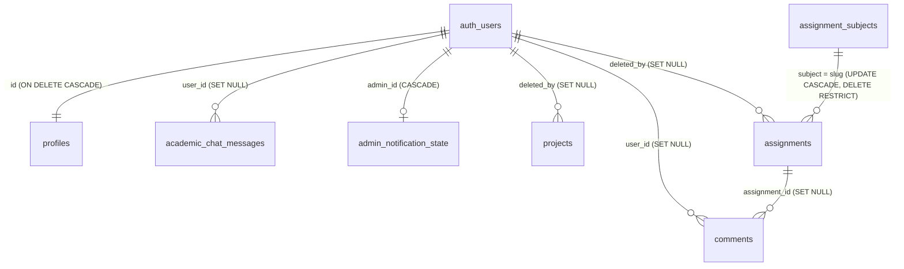

# Cấu trúc dữ liệu Supabase

> **Đã xác minh trực tiếp** qua connector Supabase ngày 28/10/2026 (chỉ đọc metadata và đếm số dòng; không đọc nội dung tin nhắn hay thông tin người dùng). Project `aqkasetqystwvpassidd`, Postgres 17, vùng `ap-southeast-1` (Singapore). Tài liệu không chứa dữ liệu người dùng.

## Bảng (schema `public`, tất cả đã bật RLS)

| Bảng | Khóa chính | Cột | Số dòng (28/10) |
| --- | --- | --- | --- |
| `profiles` | `id` uuid → `auth.users` | `name`, `role` (`user` \| `admin`, mặc định `user`), `created_at` | 3 (1 admin) |
| `projects` | `id` text | `title` (3–180 ký tự), `type`, `image_url`, `image_path`, `summary`, `tags` text[], `objective`, `data_text`, `method`, `output`, `report_files` jsonb, `sort_order`, `published` (mặc định true), `created_at`, `updated_at`, `deleted_at`, `deleted_by` | 2 (0 trong thùng rác) |
| `assignments` | `id` text | `type` (mặc định `PDF`), `title` (3–180), `topic`, `subject` → `assignment_subjects.slug`, `date_text`, `file_name`, `file_url`, `file_path`, `published`, `created_at`, `updated_at`, `day_number` (không còn dùng), `assignment_number` (> 0), `assignment_date` date, `content_text`, `external_url`, `deleted_at`, `deleted_by` | 9 (0 trong thùng rác) |
| `assignment_subjects` | `slug` | `name`, `sort_order`, `active`, `created_at`, `updated_at` | 4 |
| `comments` (nhận xét riêng) | `id` uuid | `assignment_id`, `user_id`, `name` (2–100), `role` (1–40), `body` (5–2000), `created_at`, `assignment_title`, `assignment_date`, `assignment_number`, `assignment_subject` | 2 |
| `academic_chat_messages` (thảo luận công khai) | `id` uuid | `user_id` (null = khách), `name` (2–100), `role` (1–40), `body` (1–1000), `created_at` | 0 |
| `messages` (liên hệ) | `id` uuid | `name` (2–100), `email` (5–160), `topic` (≤ 100), `message` (10–2000), `created_at` | 0 |
| `site_settings` | `key` | `value`, `updated_at` (khóa: `about_image_url`, `about_image_path`) | 2 |
| `admin_notification_state` | `admin_id` | `feedback_seen_at`, `messages_seen_at`, `updated_at` | — |
| `signup_rate_limits` | `id` | `key_hash` (SHA-256 của IP hoặc email), `created_at` | Dữ liệu tạm, tự xóa sau 24 giờ |
| `geo_ai_rate_limits` | `id` uuid | `key_hash` (SHA-256 của IP), `created_at` | Dữ liệu tạm, tự xóa sau 24 giờ |

Một số bảng có hai ràng buộc độ dài chồng nhau (ví dụ `messages.message`: 5–3000 và 10–2000); ràng buộc chặt hơn có hiệu lực.

**Index đáng chú ý:** `assignments_date_assignment_number_uidx` — duy nhất trên (`assignment_date`, `assignment_number`) **chỉ với bài chưa xóa**; index một phần cho `deleted_at`/`deleted_by`; index trên `comments(assignment_id)`, `comments(user_id)`, khóa `key_hash` của hai bảng giới hạn tần suất.

Giá trị chuẩn ghi vào database (không phụ thuộc ngôn ngữ giao diện): `messages.topic` ∈ {Trao đổi học thuật, Góp ý bài tập, Hợp tác nghiên cứu, Khác}; `comments.role` ∈ {Giảng viên, Sinh viên, Khách}; `academic_chat_messages.role` ∈ {Sinh viên, Giảng viên, Người xem}.

## Hàm và trigger

| Đối tượng | Loại | Vai trò |
| --- | --- | --- |
| `private.is_admin()` | Function `SECURITY DEFINER`, `search_path` cố định | Trả `true` nếu `profiles.role = 'admin'` cho `auth.uid()`; dùng trong hầu hết policy |
| `public.handle_new_user()` | Trigger `AFTER INSERT` trên `auth.users` (`on_auth_user_created`) | Tạo hàng `profiles`; gán quyền admin cho tài khoản chủ website theo quy tắc cố định |
| `public.touch_assignment_subject_updated_at()` | Trigger `BEFORE UPDATE` trên `assignment_subjects` | Cập nhật `updated_at` |

Không có trigger cập nhật `updated_at` cho `projects`/`assignments`; frontend tự gửi giá trị.

## Row Level Security

| Bảng | Khách (`anon`) | Người dùng đăng nhập | Admin (`private.is_admin()`) |
| --- | --- | --- | --- |
| `projects`, `assignments` | Đọc khi `published` và chưa xóa | Như khách | Đọc tất cả, thêm, sửa, xóa |
| `assignment_subjects` | Đọc khi `active` | Như khách | Đọc tất cả, thêm, sửa, xóa |
| `site_settings` | Đọc | Đọc | Thêm, sửa, xóa |
| `comments` | Không có quyền bảng | Thêm khi `user_id = auth.uid()` và bài tập đang công bố; đọc của chính mình | Đọc tất cả, xóa |
| `academic_chat_messages` | Đọc; thêm với `user_id` rỗng | Đọc; thêm với `user_id` rỗng hoặc của chính mình | Xóa |
| `messages` | Thêm | Thêm | Đọc, xóa |
| `profiles` | — | Đọc hàng của mình; sửa hàng của mình nhưng **không được đổi `role` khác `user`** | Đọc tất cả |
| `admin_notification_state` | — | — | Đọc, thêm, sửa hàng của mình |
| `signup_rate_limits`, `geo_ai_rate_limits` | Chặn hoàn toàn | Chặn hoàn toàn | Chỉ Edge Function (service role) |

Ghi chú: quyền bảng (GRANT) cho `anon`/`authenticated` đang ở mức mặc định của Supabase (gồm cả UPDATE/DELETE/TRUNCATE); RLS là lớp chặn thực tế. Cập nhật `comments` không có policy, nên frontend admin không sửa được metadata nhận xét qua API (lỗi được bỏ qua).

## Storage

| Bucket | Công khai | Giới hạn | Định dạng cho phép | Số file |
| --- | --- | --- | --- | --- |
| `assignments` | Có | 50 MB | PDF, Word, PowerPoint, Excel | 8 |
| `project-reports` | Có | 50 MB | PDF, Word, PowerPoint, Excel, `octet-stream` | 0 |
| `project-images` | Có | 6 MB | JPEG, PNG, WebP | 2 |
| `site-images` | Có | 8 MB | JPEG, PNG, WebP | 1 |

Policy `storage.objects`: mọi người được SELECT trong 4 bucket; chỉ admin được INSERT/UPDATE/DELETE. Đường dẫn file:

| Bucket | Đường dẫn |
| --- | --- |
| `assignments` | `date-<YYYY-MM-DD>/<assignment_id>/<timestamp>-<tên>`; bản tải lại: `<assignment_id>/<timestamp>-<tên>` |
| `project-images` | `<project_id>/<timestamp>-<tên>` (ảnh nén WebP ≤ 1600 px trước khi tải lên) |
| `project-reports` | `<project_id>/<timestamp>-<i>-<tên>` |
| `site-images` | `about/<timestamp>-<tên>` |

## Edge Functions

Cả 3 function đặt `verify_jwt = false` và tự kiểm tra bên trong: chỉ nhận `POST` từ origin của website (và `localhost:3000` để phát triển), dùng biến môi trường `SUPABASE_URL`, `SUPABASE_SERVICE_ROLE_KEY` do Supabase cấp.

| Function | Phiên bản | Kiểm tra quyền | Xử lý |
| --- | --- | --- | --- |
| `geo-ai` | 5 | Publishable key hợp lệ; giới hạn 20 câu/10 phút và 60 câu/giờ theo IP | Chào hỏi/giới thiệu → trả lời cố định; ngoài phạm vi địa chất–địa vật lý → từ chối; câu hỏi về dự án/bài tập → tìm trong dữ liệu công khai; câu hỏi chuyên môn → gọi OpenAI nếu có `OPENAI_API_KEY` (model theo `OPENAI_MODEL`), nếu không dùng 19 mục kiến thức có sẵn. Luôn trả lời tiếng Việt |
| `signup-no-confirm` | 3 | Không cần đăng nhập; giới hạn 8 lần/giờ theo IP và 3 lần/giờ theo email | Kiểm tra họ tên ≥ 2, email, mật khẩu 8–72 ký tự; tạo tài khoản **đã xác nhận email** |
| `admin-user-management` | 2 | JWT hợp lệ + `profiles.role = 'admin'` (kiểm tra phía server) | `list` (≤ 1000 tài khoản), `confirm`, `delete` (không xóa được admin hay chính mình; nhận xét và tin nhắn của tài khoản bị xóa được giữ lại, bỏ liên kết người dùng) |

Mã nguồn hiện chỉ nằm trên Supabase; nên đưa bản sao vào `supabase/functions/` trong repository.

## Realtime

Bảng được phát qua `supabase_realtime`: `projects`, `assignments`, `comments`, `messages`, `academic_chat_messages`, `site_settings`. Realtime tôn trọng RLS, nên khách chỉ nhận thay đổi của dòng họ được đọc.

`assignment_subjects` **không** nằm trong publication, nên đăng ký theo dõi bảng này ở `index.html` không bao giờ nhận sự kiện.

## Migration

26 migration (28/09 → 30/09/2026), áp dụng trực tiếp trên dự án, chưa có trong repository. Mốc chính: `initial_portfolio_schema`, `harden_admin_rls_functions`, `bootstrap_owner_admin_email`, `assignments_use_calendar_date`, `preserve_academic_discussions`, `academic_live_chat`, `add_site_settings_and_about_image_admin`, `add_signup_rate_limit_table`, `add_admin_notification_state`, `add_content_trash_soft_delete`, `harden_public_content_and_trash_indexes`.

## Cảnh báo từ Supabase Advisor (28/10)

- Bảo mật: **Leaked Password Protection** đang tắt (chặn mật khẩu đã bị lộ qua HaveIBeenPwned).
- Hiệu năng: 10 index chưa từng được dùng — bình thường với lượng dữ liệu rất nhỏ hiện nay, chưa cần xóa.
